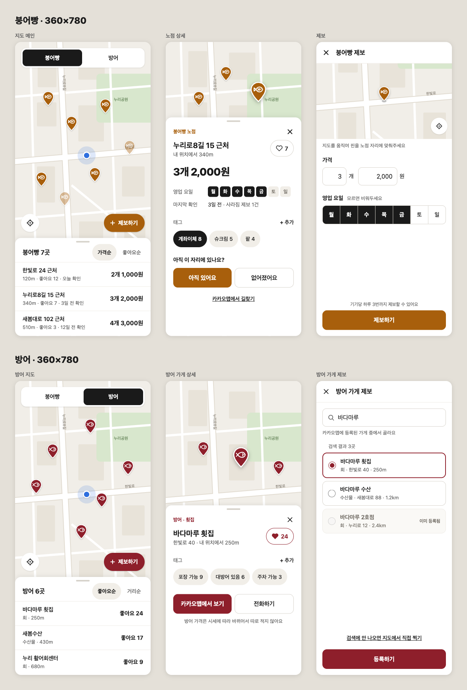

# season-ing

지금 제철인 음식을 어디서 먹을 수 있는지 지도로 찾는 서비스입니다.
첫 계절은 **겨울**이고, 붕어빵 노점과 방어 가게부터 다룹니다.

## 이름: season-ing

**season**(제철) + **-ing**(지금 ~하는 중), 그러니까 "지금 제철인 것"이라는 뜻입니다.

처음 만드는 건 겨울 음식 지도지만, 이름에 "겨울"을 넣지 않았습니다.
나중에 봄·여름·가을 제철 음식도 같은 서비스에 올릴 생각이라서 이름을 특정 계절에 묶지 않았습니다.
코드도 그렇게 짜 두었습니다. 음식 종류는 `PlaceCategory` 하나로 관리하기 때문에, 새 음식을 넣을 때는 아래 [새 제철 음식 추가하기](#새-제철-음식-추가하기)에 적은 곳만 고치면 됩니다.

## 지금 다루는 음식

| 음식 | 어디서 파나 | 지도에 보여주는 정보 |
| --- | --- | --- |
| 붕어빵 | 길거리 **노점**: 위치가 자주 바뀌고 카카오맵에 없는 곳이 많음 | 가격(예: 3개 2,000원), 영업 요일, 마지막 확인 날짜, 좋아요, 태그 |
| 방어 | 횟집·수산시장 같은 **가게**: 카카오맵에 등록되어 있음 | 가게 이름, 업종, 전화번호, 좋아요, 태그 |

방어 가격은 시세에 따라 매일 바뀌어서 일부러 적지 않습니다.

## 화면 디자인



360×780 모바일 화면 6개입니다. 윗줄이 붕어빵, 아랫줄이 방어입니다.

| | 지도 메인 | 상세 | 제보 |
| --- | --- | --- | --- |
| 붕어빵 | 카테고리 탭, 핀, 가격순·좋아요순 목록 | 가격, 영업 요일, 마지막 확인, 태그, "아직 있어요 / 없어졌어요" | 지도로 핀 위치 맞추기, 개수·가격, 영업 요일 |
| 방어 | 카테고리 탭, 핀, 좋아요순·거리순 목록 | 가게 정보, 태그, 카카오맵 보기, 전화하기 | 카카오맵에 등록된 가게 검색해서 고르기 |

### 디자인을 만든 방법

1. **Claude 디자인 캔버스에서 화면부터 그렸습니다.** ([디자인 캔버스](https://claude.ai/artifact/DRpbz78cTFH4PYzYpRDNzQ). 비공개라서 공유받은 사람만 열 수 있습니다.)
   - 붕어빵과 방어를 줄 단위로 나누고, 줄마다 지도 → 상세 → 제보 순서로 화면을 놓았습니다.
   - 음식마다 색을 하나씩 정했습니다. 붕어빵은 구운 빵 색 `#A85F0C`, 방어는 방어 살 색 `#8E1F2B`입니다. 핀, 제보 버튼, 상세 화면 라벨에 이 색을 씁니다.
   - 핀 아이콘도 음식마다 따로 그렸습니다(붕어빵 모양 / 생선 모양).
2. **캔버스에서 정한 값을 그대로 디자인 토큰으로 옮겼습니다.** [`src/b_app/styles/globals.css`](src/b_app/styles/globals.css)의 Tailwind `@theme`에 색·글자 크기·모서리·그림자를 넣었습니다. Tailwind 기본 팔레트는 지워서 토큰에 없는 색은 클래스로 쓸 수 없게 했습니다.
3. **모바일에서 쓰기 편하게 맞췄습니다.**
   - 버튼 같은 터치 영역은 최소 44px로 잡았습니다(`--spacing-touch`).
   - 입력창 글자는 16px입니다. 이보다 작으면 iOS 사파리가 입력창을 누를 때 화면을 확대합니다.
   - 화면 폭은 최대 480px(`--container-app`)이고, 데스크톱에서는 가운데에 놓입니다.

위 이미지는 캔버스의 화면 소스를 그대로 렌더링해서 찍은 것입니다.

## 기술 스택

| 분류 | 사용한 것 |
| --- | --- |
| 프레임워크 | Next.js 16 (App Router, `cacheComponents`), React 19 |
| 언어 | TypeScript |
| 스타일 | Tailwind CSS v4 (`@theme` 디자인 토큰) |
| 지도 | 카카오 지도 JavaScript SDK ([react-kakao-maps-sdk](https://github.com/JaeSeoKim/react-kakao-maps-sdk)), 장소 검색(`services` 라이브러리) |
| 패키지 매니저 | pnpm |

## 폴더 구조

[Feature-Sliced Design](https://feature-sliced.design/)을 따릅니다. 레이어 폴더 앞의 `b_`, `c_`, `d_`는 폴더가 레이어 순서대로 정렬되게 붙인 접두사입니다.
위 레이어만 아래 레이어를 가져다 쓸 수 있습니다(`app` → `b_app` → `c_features` → `d_shared`).

```text
src/
├── app/                  # Next.js 라우트
│   ├── page.tsx          # 지도 메인 (?category=bungeoppang | bangeo)
│   └── report/
│       ├── bungeoppang/  # 붕어빵 노점 제보
│       └── bangeo/       # 방어 가게 제보
├── b_app/
│   └── styles/           # 전역 스타일, 디자인 토큰
├── c_features/
│   ├── place-browse/     # 지도·목록·상세 시트
│   └── place-report/     # 제보 화면
└── d_shared/
    ├── place/            # 장소 타입, 음식 카테고리, 핀
    ├── geo/              # 좌표, 거리 계산, 현재 위치
    ├── kakao-map/        # 카카오 SDK 로딩, 장소 검색
    ├── format/           # 숫자 표시
    └── ui/               # 공용 아이콘, 버튼
```

## 동작 규칙

- **장소 찾기**: 지도를 움직이면 화면에 보이는 영역 안에서 카카오 장소 검색을 다시 합니다. 붕어빵은 "붕어빵", 방어는 "방어"와 "대방어"로 검색하고, 같은 가게가 두 번 나오면 하나로 합칩니다.
- **정렬**: 붕어빵은 가격순(개당 가격 기준)·좋아요순, 방어는 좋아요순·거리순입니다.
- **노점이 아직 있는지**: 노점은 사라지기도 해서 마지막으로 확인된 날짜를 봅니다. 날짜는 한국 시간 기준으로 셉니다.
  - 7일 안에 확인됨: 그대로 보여줍니다.
  - 7일 넘음: 핀을 흐리게 보여줍니다.
  - 30일 넘음, 또는 "없어졌어요" 제보 3건 이상: 지도와 목록에서 숨깁니다.

순서를 바꾸거나 판단만 하는 로직(정렬, 신선도, 거리, 가격 표시)은 React와 떨어진 순수 함수로 [`src/c_features/place-browse/model/`](src/c_features/place-browse/model/)에 모아 두었습니다.

## 지금 상태

**동작하는 것**

- 카카오 지도, 내 위치 표시와 내 위치로 이동
- 붕어빵 / 방어 탭 전환 (URL의 `?category=`로 유지)
- 지도 영역 검색 결과를 핀과 목록으로 표시, 정렬
- 가게 상세 시트: 카카오맵 장소 페이지 열기, 전화 걸기
- 제보 화면: 지도로 위치 고르기, 가격·요일 입력, 방어 가게 검색

**아직 안 된 것**

- 저장소(백엔드)가 없습니다. 그래서 제보하기, 좋아요, 태그 추가, "아직 있어요 / 없어졌어요" 버튼은 화면만 있고 누르면 아무 일도 일어나지 않습니다.
- 노점 데이터는 제보가 저장되어야 생깁니다. 지금 지도에 뜨는 건 카카오 장소 검색으로 찾은 가게뿐입니다.
- "기기당 하루 3번까지 제보" 제한은 안내 문구만 있습니다.
- 테스트가 아직 없습니다.

## 시작하기

### 1. 카카오 지도 키 준비

1. [Kakao Developers](https://developers.kakao.com/)에서 앱을 만들고 **JavaScript 키**를 복사합니다.
2. 앱 설정에서 JavaScript SDK를 쓸 도메인으로 `http://localhost:3000`을 등록합니다. 등록하지 않으면 지도가 뜨지 않습니다.

### 2. 환경 변수

프로젝트 루트에 `.env.local`을 만듭니다.

```bash
NEXT_PUBLIC_KAKAO_MAP_KEY=발급받은_JavaScript_키
```

키가 없으면 지도 자리에 "카카오 지도 키(NEXT_PUBLIC_KAKAO_MAP_KEY)가 설정되지 않았어요"가 나옵니다.

### 3. 실행

```bash
pnpm install
pnpm dev
```

[http://localhost:3000](http://localhost:3000)에서 열립니다. 위치 권한을 허용하면 내 위치 주변을, 허용하지 않으면 서울시청 주변을 먼저 보여줍니다.

| 명령 | 하는 일 |
| --- | --- |
| `pnpm dev` | 개발 서버 |
| `pnpm build` | 프로덕션 빌드 |
| `pnpm start` | 빌드 결과 실행 |
| `pnpm lint` | ESLint |

## 새 제철 음식 추가하기

음식 카테고리별 설정은 모두 `Record<PlaceCategory, …>` 타입이라, `PlaceCategory`에 새 값을 넣으면 빠진 곳을 TypeScript가 에러로 알려줍니다.

1. [`src/d_shared/place/place.ts`](src/d_shared/place/place.ts): `PlaceCategory`에 새 음식 추가. 노점형이면 `StallCategory`에도 추가합니다.
2. [`src/b_app/styles/globals.css`](src/b_app/styles/globals.css): 음식 색 토큰 `--color-<음식>` 추가
3. [`src/d_shared/place/place-category.ts`](src/d_shared/place/place-category.ts): 이름, 색 클래스, 탭 순서(`PLACE_CATEGORY_ORDER`)
4. [`src/d_shared/place/place-pin.tsx`](src/d_shared/place/place-pin.tsx): 핀 아이콘
5. [`src/c_features/place-browse/model/kakao-shop-search.ts`](src/c_features/place-browse/model/kakao-shop-search.ts): 카카오 검색 키워드
6. [`src/c_features/place-browse/model/list-places.ts`](src/c_features/place-browse/model/list-places.ts): 정렬 옵션
7. `src/app/report/<음식>/page.tsx`: 제보 화면. 노점형은 `StallReportForm`, 가게형은 `ShopReportForm`을 씁니다.
